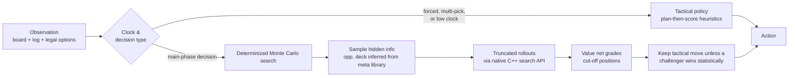

# ptcg-ai-agent

A game-playing AI for the [Pokémon TCG AI Battle Challenge](https://www.kaggle.com/competitions/pokemon-tcg-ai-battle)
(Kaggle, 2026), **built end-to-end through an AI-integrated workflow**: I directed
[Claude](https://www.anthropic.com/claude) as the engineering collaborator, and it
planned, implemented, and measured each version of the agent with me.

The point of this repo is to show **working with AI to build AI agents**: using one AI
system to design, build, and rigorously evaluate another under a real competition
deadline.

**Best result:** the final agent (v9) won **74% of games (95% CI 64.6–81.6%, n=100)**
against the ~800-Elo public benchmark agent, up from 18.5% for the original priority-heuristic
baseline.

---

## How it was built

The code was written by Claude from my prompts. My job was the parts an engineer
leading a project owns: setting goals, making the design calls, running the
Kaggle/ladder side, and deciding what shipped. The workflow:

1. **Plan before code.** Before writing anything, we wrote a full project plan
   ([ROADMAP.md](ROADMAP.md)): competition constraints, which
   AI techniques fit and which are dead ends, milestones, architecture, and risks.
2. **Every change is an experiment.** Each agent version was A/B tested locally over
   hundreds of games with Wilson confidence intervals before it went to the ladder.
   Changes that didn't separate statistically didn't ship.
3. **Live feedback closes the loop.** Ladder replays were mined and fed back in. For
   example, a 64-game loss autopsy showed 17% of losses were deck-outs, which led to the
   v8 deck-out guards, and a v7 rating drop (879 → 458) was traced to endgame rollouts
   overrunning the clock.
4. **Commit history as a lab notebook.** Each commit records what changed, why, and the
   measured result, so the history reads as a record of decisions. Commits are
   co-authored by Claude.

## What the agent does



- **Imperfect information:** the opponent's hand, both decks, and the prizes are hidden.
  The search samples plausible hidden states, infers the opponent's deck from cards
  they've revealed (matched against a library of mined meta decks), and runs rollouts
  through the engine's native search API.
- **Search that can't make things worse:** raw rollout argmax *lost* to its own rollout
  policy (39% vs 50%) because noise outweighed a good prior. Selection is now anchored
  to the tactical move and only switches when a challenger wins by a statistically
  meaningful margin.
- **Learned evaluation:** a value net trained on 9,773 mined expert positions plus
  63,371 self-play positions predicts the winner 76.2% of the time on held-out games.
  It grades truncated rollouts in place of a hand-tuned board evaluation. Inference
  is pure numpy, since the submission bundle has no torch.
- **Clock safety:** each player gets one 600-second pool per game, and running out is an
  instant loss. Every decision gets a slice of the remaining clock, below a reserve the
  agent drops to the instant tactical policy, and every layer falls back instead of
  raising (value net → hand eval → tactical → random-legal).
- **Imitation learning (shelved):** a behavior-cloned option ranker trained on 86,914
  decisions from top ladder teams reached 48.8% expert top-1 accuracy. It was set aside
  once the value net measured better.

## Results

All local results use alternating seats; win rates are vs the public ~800-Elo pixiux
agent unless noted.

| Version | Change | Result |
|---|---|---|
| v0–v5 | Priority heuristics, MC search, BC ranker | priority baseline 18.5% |
| tactical | Plan-driven policy rebuilt on the pixiux pattern | 50.0%; 87.0% vs the old priority agent |
| v6 | Prior-anchored search, 10× faster rollouts | ladder rating ~879 |
| v7–v8 | Board-aware eval, endgame gate, clock caps, deck-out guards | hand-eval search ~64% |
| **v9** | **Value net grades rollouts** | **74.0%, CI [64.6, 81.6], n=100 at 2 s/decision** |

## Layout

```
ptcg/
├── agents/        # every agent is agent(obs) -> list[int]
│   ├── tactical.py      # plan-then-score policy; rollout policy + fallback
│   ├── learned.py       # numpy inference for the trained nets
│   └── search/          # MC search, determinization, opponent-deck inference
├── data/          # ladder scouting, replay parsing, trajectory extraction
├── training/      # BC ranker + value net training (torch), npz export
├── eval/          # head-to-head matches with Wilson CIs
├── engine/        # thin wrappers around the cabt engine
├── decks/         # 60-card lists, incl. a mined meta library
└── submission/    # Kaggle bundle builder that plays a full game before packing
docs/              # engine notes, cloud training guide
data/kernels/      # third-party public notebooks used as reference
tests/             # full-game smoke tests, determinization tests
```

## Running it

Requires [uv](https://docs.astral.sh/uv/) and a Kaggle API token saved at
`~/.kaggle/access_token`.

```sh
uv sync                                   # Python 3.11 + deps, incl. the cabt engine
uv run python tools/fetch_official.py     # official card DB + SDK (gitignored, ~10 MB)
uv run pytest                             # full games through the engine
uv run python -m ptcg.eval.match ptcg.agents.tactical ptcg.agents.priority_agent -n 400
uv run python -m ptcg.submission.build    # build + verify the Kaggle bundle
```

Training data is regenerable via `ptcg.data`, or download it with
`kaggle datasets download gabemccrea/ptcg-train-data`. Training deps:
`uv sync --group train`.
